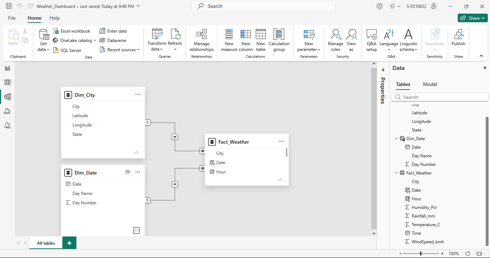
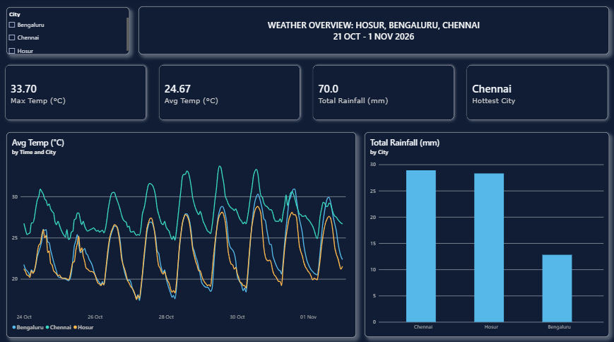
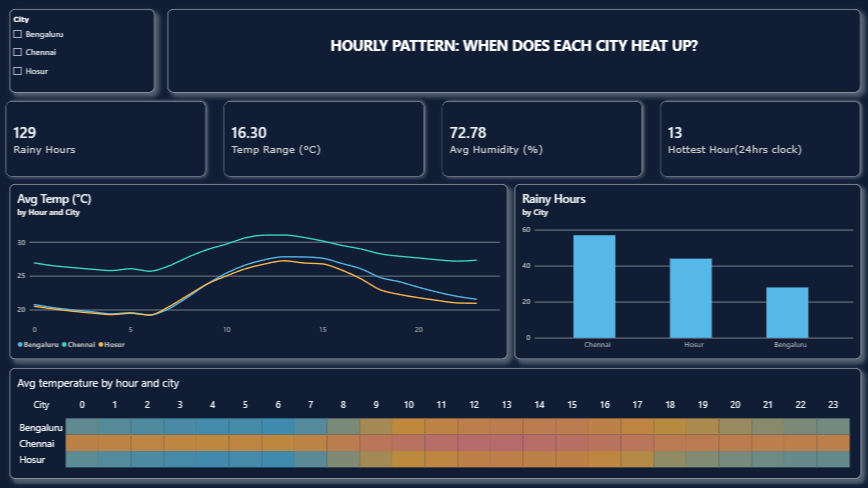

# Weather Dashboard : Hosur, Chennai, Bengaluru

A two-page Power BI dashboard that models hourly weather data for three South Indian cities in a star schema and shows how temperature, rainfall and humidity differ by city and by hour of the day.

**Data period:** 24 Oct – 1 Nov 2026 (hourly)
**Records:** 648 rows (216 hours × 3 cities)
**Source:** [Open-Meteo](https://open-meteo.com/) forecast API (free, no key)
**Tools:** Power BI Desktop, Power Query (M), DAX

---

## Screenshots

### Data model (star schema)

### Page 1: Weather Overview

### Page 2: Hourly Pattern

---

## Business questions answered

1. Which city is the warmest, and by how much?
2. At what time of day does each city heat up and cool down?
3. How much rain fell in each city, and in how many hours?

---

## Data model

| Table | Type | Contents |
|---|---|---|
| `Fact_Weather` | Fact | Hourly Time, Temperature_C, Humidity_Pct, Rainfall_mm, WindSpeed_kmh, City, Date, Hour |
| `Dim_City` | Dimension | City, State, Latitude, Longitude |
| `Dim_Date` | Dimension | Date, Day Name, Day Number |

Relationships: `Dim_City[City]` → `Fact_Weather[City]` and `Dim_Date[Date]` → `Fact_Weather[Date]`, both one-to-many with single-direction filtering.

---

## Data preparation (Power Query)

- Loaded one hourly weather file per city and removed the 3-line location header from each file.
- Promoted headers, dropped an empty trailing column, renamed columns (no units or symbols in names).
- Set data types, parsing the ISO timestamp (`2026-10-24T00:00`) as Date/Time.
- Added a `City` column to each table, then appended the three tables into `Fact_Weather` (648 rows).
- Disabled load on the three source queries so only the model tables reach the report.

---

## DAX measures (9)

| Measure | Purpose |
|---|---|
| `Avg Temp (°C)` | Average temperature |
| `Max Temp (°C)` | Highest temperature |
| `Min Temp (°C)` | Lowest temperature |
| `Temp Range (°C)` | Max minus min |
| `Avg Humidity (%)` | Average relative humidity |
| `Total Rainfall (mm)` | Sum of rainfall |
| `Rainy Hours` | Count of hours with rainfall above 0 |
| `Hottest City` | City with the highest average temperature |
| `Hottest Hour` | Hour of day (24-hour clock) with the highest average temperature |

---

## Key findings

- Across all three cities, the maximum temperature was 33.7 °C and the average was 24.7 °C. Chennai had the highest average temperature.
- Chennai was warmer than the other two cities at every hour of the day. Its afternoon peak was about 31 °C, against about 27–28 °C for Bengaluru and Hosur.
- Hosur and Bengaluru followed almost the same daily curve, which fits with the two cities being only about 40 km apart.
- The average temperature peaks around 1 PM (hour 13) and bottoms out in the early morning hours.
- Total rainfall across the three cities was 70 mm over the period, with 129 rainy hours in total. Bengaluru alone recorded 12.8 mm.

---

## How to open the report

1. Download this repository.
2. Open `Weather_Dashboard.pbix` in Power BI Desktop (Windows).
3. If Power BI says it cannot find the source files, go to **Transform data → Data source settings → Change Source** and point each file to the matching CSV in the `data/` folder.
4. Click **Close & Apply**, then **Refresh**.

### Updating the data

The CSV files in `data/` are downloads from the Open-Meteo API (hourly temperature, humidity, precipitation and wind speed, past 7 days plus 2 forecast days, timezone Asia/Kolkata). To refresh them, request the same API again for each city:

| City | Latitude | Longitude |
|---|---|---|
| Hosur | 12.74 | 77.83 |
| Chennai | 13.08 | 80.27 |
| Bengaluru | 12.97 | 77.59 |

---

## Limitations

- The dashboard reads **downloaded CSV files**, so it does not update automatically. It is not a live or real-time feed.
- The period is only about nine days, so the findings describe this window, not the climate of these cities.
- The window includes a 2-day forecast, so part of the data is predicted weather rather than observed.
- Not published to Power BI Service, so there is no scheduled refresh or row-level security.

---

## Next steps

- Connect directly to the API for refreshable data.
- Publish to Power BI Service with scheduled refresh.
- Add more cities and a longer history to compare seasons.

---

## Author

**VARSHINI GANESAN**
[GitHub](https://github.com/vrshy) · [LinkedIn](https://linkedin.com/in/varshiganesan)
